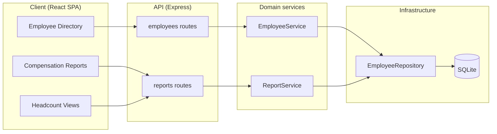

# Spec: Give ACME's HR Manager a web tool to manage and query 10,000 employees' salary data instead of Excel

> Owned by: avani@incubyte.co  ·  Started: 2026-09-29  ·  Last revised: 2026-09-29  ·  Spec UUID: 547df071-01ae-4e3d-b877-1a971539a8a6
> Anthara spec — slice-decomposed, categorically-framed. Feeds /anthara:create-ticket and /anthara:plan-implementer.

---

## At a glance

| | |
|---|---|
| **In one line** | Replace ACME's Excel-based salary tracking with a web app where the HR Manager can browse, edit, and query pay data for 10,000 employees across multiple countries. |
| **Slices** | 9, built in the order listed in [§5](#5-slices) |
| **Architectural style** | Modular monolith, domain-based modules, layered intra-module — from [§7.2](#72-architectural-style) |
| **Active packs** | Accessibility Checklist, Clean Code, Incubyte Engineering Standards, SonarJS Violations (JS/TS) |
| **Open questions** | 0 — none outstanding; see [§9](#9-deferred-follow-ups-and-accepted-limits) for scope cuts made instead |

## 1. Overview & business context

**The problem.** ACME's HR team currently tracks salary data for 10,000 employees across multiple countries in spreadsheets. Excel does not scale to this row count for day-to-day lookups, cannot answer aggregate questions ("what's the average salary in Engineering in Germany?") without manual pivot work, and offers no structured way to add, correct, or search employee compensation records.

**Who it is for.** The [HR Manager](#31-kinds-of-users) — the single user kind in this spec — who needs to browse and search the employee roster, keep individual records accurate, and answer pay-distribution questions for the organization.

**What this spec commits to.** A browser-based single-page app backed by a REST API and a relational database: an employee directory with search and filtering, full CRUD on employee records, two categories of compensation reporting (stats-by-dimension and headcount/distribution), CSV export of any filtered view, and a deterministic seed script that populates 10,000 realistic employee records for development and grading.

**Deliberately out of scope.** No authentication/authorization, no salary-history/audit trail (only the current salary is tracked), no cross-currency aggregation or live FX rates, no Excel/CSV *import* pipeline, no org-chart or manager-hierarchy modeling, and no employee self-service view. Each cut is reasoned in [§9](#9-deferred-follow-ups-and-accepted-limits).

## 2. Sources

| ID | Type | Contributor | Date | Description |
|---|---|---|---|---|
| 1 | Project brief | ACME hiring assessment (`kata.md`, this repo) | 2026-09-29 | Goal, persona, requirements, and technical constraints for the exercise. |
| 2 | Org Memory (`mcp__plugin_anthara_anthara-fabric__get_relevant_standards`) | Fabric | 2026-09-29 | Active standard packs for this repo: Accessibility Checklist, Clean Code, Incubyte Engineering Standards, SonarJS Violations (JS/TS), SOC 2 Agent Verification Controls. |
| 3 | Codebase (this repo) | n/a | 2026-09-29 | Empty greenfield repo containing only `kata.md` at the time of writing. |
| 4 | Live spec-writing session with avani@incubyte.co | avani@incubyte.co | 2026-09-29 | Tech stack, MVP report scope, currency modeling, layout, and implementation-approach decisions made via `AskUserQuestion` during this session. |

## 3. Type ontology

### 3.1 Kinds of users
- **HR Manager** — the sole user kind in v1; an implicit, unauthenticated actor who browses, edits, and reports on employee compensation data [1, 4].

### 3.2 Kinds of data
- **Employee** — one compensation record: name, email, department, country, job level, currency, salary amount, hire date [1].
- **Department** — a fixed organizational grouping (Engineering, Sales, Marketing, Finance, HR, Operations, Legal, Customer Support) that an employee belongs to [4].
- **Country** — a fixed country of employment, carrying an ISO country code and a default ISO 4217 currency code [1, 4].
- **Job level** — a fixed, ranked seniority band (L1 Associate … L6 Executive) used for both individual records and compensation grouping [4].
- **Compensation statistic** — a derived (never stored) aggregate: average/median/min/max salary for a given department, country, or job level, computed within a single currency [4].
- **Headcount distribution** — a derived (never stored) count of employees grouped by department, country, or job level, or bucketed by salary band [4].

### 3.3 Kinds of events
- **EmployeeCreated** — fires when the HR Manager adds a new employee via [slice 5.4](#54-add-a-new-employee).
- **EmployeeUpdated** — fires when the HR Manager edits an existing employee's details or salary via [slice 5.5](#55-edit-an-employees-details-and-salary).
- **EmployeeDeleted** — fires when the HR Manager removes a record entered in error via [slice 5.6](#56-remove-an-employee-record).
- **DatabaseSeeded** — fires once, when the seed script (`npm run seed`) populates 10,000 employees via [slice 5.1](#51-seed-the-database-with-10000-employees).

### 3.4 Kinds of states
- **Employee — persisted** — the only lifecycle state a record has in v1; there is no draft, pending, or terminated state (see [§9.2](#9-deferred-follow-ups-and-accepted-limits)).
- **Report query — loading / loaded / empty / errored** — the four states any report or directory view can be in, per the [minimal empty-state treatment](#implementation-approach) chosen in this session [4].

## 4. Invariants

**4.1 One department, one country, one job level** — every employee belongs to exactly one department, one country, and exactly one job level; none of the three is ever null or multi-valued. Sources: [1, 4].

**4.2 Salary is an integer minor-unit amount paired with a currency** — every employee's salary is stored as a non-negative integer in the currency's minor unit (cents, paise, pence — never a floating-point major-unit value), paired with a three-letter ISO 4217 currency code. Storing minor units avoids floating-point rounding error in aggregate SQL queries. Sources: [4].

**4.3 Compensation statistics never mix currencies** — average/median/min/max salary is only ever computed across records sharing one currency; the API never sums or averages amounts across different currencies. Cross-currency organization-wide totals are out of scope ([§9.3](#9-deferred-follow-ups-and-accepted-limits)). Sources: [4].

**4.4 An employee's currency is fixed at creation** — an employee's `currencyCode` is set once, to their country's default currency, when the record is created, and does not change except through the (out-of-scope) relocation flow described in [§9.3](#9-deferred-follow-ups-and-accepted-limits). Sources: [4].

**4.5 CSV export mirrors the active filter exactly** — a CSV export request returns every row matching the request's filter/search parameters and no others, regardless of what page the directory happened to be showing on screen. Sources: [4].

**4.6 Employee IDs are unique and never reused** — every employee record has a system-assigned integer ID that uniquely identifies it and is never reassigned to a different employee, even after the original record is deleted. Sources: [4].

## 5. Slices

| # | Slice | What the user can do once it lands | Entry | Reached from |
|---|---|---|---|---|
| 5.1 | Seed the database with 10,000 employees | Run one command and get a fully populated, realistic dataset | `npm run seed` (CLI) | `root` |
| 5.2 | View and search the employee directory | Browse, search, and filter all 10,000 employees in a paginated table | Directory nav item | `root` |
| 5.3 | View an employee's detail | Click a row to see one employee's full record in a side panel | Row click → detail panel | Directory table (5.2) |
| 5.4 | Add a new employee | Create a new employee record via a form | "Add Employee" button | Directory page (5.2) |
| 5.5 | Edit an employee's details and salary | Correct or update an existing employee's record | "Edit" action | Detail panel (5.3) |
| 5.6 | Remove an employee record | Delete a record entered in error | "Delete" action | Detail panel (5.3) |
| 5.7 | View compensation statistics by dimension | See avg/median/min/max salary by department, country, or job level | "Compensation Reports" nav item | `root` |
| 5.8 | View headcount and salary distribution | See headcount and salary-band distribution by department, country, or job level | "Headcount" nav item | `root` |
| 5.9 | Export the current view to CSV | Download the employees or report rows currently on screen as a CSV file | "Export CSV" button | Directory page (5.2); Compensation Reports (5.7); Headcount (5.8) |

Filled rows read like: `root` → *the seed CLI command*; *the directory table* (5.2) → *a row click opening the detail panel*; the Export CSV Entry is reachable from three different Hosts (5.2, 5.7, 5.8), so all three are listed.

### 5.1 Seed the database with 10,000 employees

A developer or grader runs `npm run seed` against an empty database. The script creates the schema (departments, countries, job levels, employees tables) if it does not exist, then deterministically generates and inserts 10,000 employee records: names, emails, one of 8 departments, one of 6 countries (each with its own default currency), one of 6 job levels, and a salary drawn from a realistic band for that job level and country (with department and random variance layered on top, all from a fixed RNG seed so re-running produces the identical dataset).

*Types: [Employee, Department, Country, Job level](#3-type-ontology) · Invariants: [4.1, 4.2, 4.4](#4-invariants).*

```
$ npm run seed
Seeding schema...                done
Seeding 8 departments...         done
Seeding 6 countries...           done
Seeding 6 job levels...          done
Seeding 10,000 employees...      done (12,345 ms)
Seed complete. Re-run to reset — seeding is idempotent (truncates + re-inserts).
```

**Acceptance criteria**

- [x] **5.1.1** Running `npm run seed` against a fresh database results in exactly 8 departments, 6 countries, 6 job levels, and 10,000 employees.
- [x] **5.1.2** Every seeded employee's salary falls within a realistic band for its job level (e.g. L1 salaries never exceed L6 salaries in the same country), so aggregate compensation queries produce meaningfully differentiated, non-uniform results.
- [x] **5.1.3** Every seeded employee's `currencyCode` matches its country's default currency, per [invariant 4.4](#4-invariants).
- [x] **5.1.4** Running `npm run seed` twice in a row produces byte-identical row counts and the same salary distribution (fixed RNG seed) — the script is idempotent, truncating before it re-inserts.
- [x] **5.1.5** Seeding 10,000 rows completes in under 30 seconds on a developer machine (performance floor for local iteration and CI).

### 5.2 View and search the employee directory

The HR Manager lands on the Directory page and sees a paginated, sortable table of all employees (name, department, country, job level, salary, hire date). A search box and filter dropdowns (department, country, job level) sit in a bar above the table; typing a name or choosing a filter re-queries the server and updates the table without a full page reload.

*Types: [Employee, Department, Country, Job level](#3-type-ontology) · Invariants: [4.1](#4-invariants).*

```
┌─ ACME Salary Manager ─────────────────────────────────────┐
│ ▌ Directory   Compensation Reports   Headcount             │
├──────────────────────────────────────────────────────────┤
│ [Search name...] [Department ▾] [Country ▾] [Level ▾]      │
│                                          [Export CSV]       │
├──────────────────────────────────────────────────────────┤
│ Name          Dept        Country  Level  Salary   Hired   │
│ Jane Doe      Engineering Germany  L4     €95,000  2021-03 │
│ John Smith    Sales       US       L2     $62,000  2022-07 │
│ ...                                                          │
├──────────────────────────────────────────────────────────┤
│ ◀ 1 2 3 ... 500 ▶            Rows per page: 20 ▾            │
└──────────────────────────────────────────────────────────┘
```

**Acceptance criteria**

- [ ] **5.2.1** `GET /api/employees?page&pageSize&search&department&country&jobLevel&sortBy&sortDir` returns a page of matching employees plus a total count, using server-side `LIMIT`/`OFFSET`.
- [ ] **5.2.2** Typing in the search box filters by case-insensitive substring match on first or last name.
- [ ] **5.2.3** Selecting a department, country, or job level filter narrows the result set; filters combine with AND semantics and with the active search term.
- [ ] **5.2.4** Sorting by any visible column (name, department, country, level, salary, hire date) re-orders the server-side query, not just the current page.
- [ ] **5.2.5** With zero matching rows, the table shows the minimal empty state (centered text + icon) rather than a blank table.
- [ ] **5.2.6** A request for an out-of-range page (e.g. beyond the last page) returns an empty `items` array with the correct `total`, not a 4xx error.

### 5.3 View an employee's detail

Clicking any row in the directory opens a side panel showing that employee's full record without navigating away from the table (so the HR Manager keeps their place in a large, filtered list).

*Types: [Employee](#3-type-ontology) · Invariants: [4.1, 4.2](#4-invariants).*

**Acceptance criteria**

- [ ] **5.3.1** `GET /api/employees/:id` returns the full employee record (all fields from [§3.2](#3-type-ontology)) or `404` with a `{ code: "EMPLOYEE_NOT_FOUND", message }` body when the ID does not exist.
- [ ] **5.3.2** Clicking a directory row opens the detail panel populated with that row's data without a full-page navigation; the directory table remains visible and scrolled to the same position.
- [ ] **5.3.3** Closing the panel (via an explicit close control or `Escape`) returns focus to the row that opened it, per the Accessibility Checklist's focus-management rule.

### 5.4 Add a new employee

The HR Manager clicks "Add Employee" on the Directory page, fills a form (name, email, department, country, job level, salary, hire date), and submits it to create a new record that immediately appears in the directory.

*Types: [Employee](#3-type-ontology) · Invariants: [4.1, 4.2, 4.4, 4.6](#4-invariants).*

**Acceptance criteria**

- [ ] **5.4.1** `POST /api/employees` with a valid payload creates the employee, assigns a new unique ID, sets `currencyCode` to the chosen country's default (per [invariant 4.4](#4-invariants)), and returns `201` with the created record.
- [ ] **5.4.2** Submitting the form with a missing required field (name, email, department, country, job level, or salary) is blocked client-side with an inline field error before any request is sent.
- [ ] **5.4.3** `POST /api/employees` with a missing required field, a malformed email, or a negative salary returns `422` with a `{ code: "VALIDATION_ERROR", fields: [...] }` body listing every invalid field.
- [ ] **5.4.4** On success, the new employee appears in the directory's current view (if it matches the active filters) without requiring a manual page refresh.
- [ ] **5.4.5** The salary input accepts a major-unit decimal amount (e.g. `95000.00`) and the API stores it converted to minor units (e.g. `9500000`), per [invariant 4.2](#4-invariants).

### 5.5 Edit an employee's details and salary

From the detail panel, the HR Manager clicks "Edit", changes one or more fields (including salary), and saves — correcting a data-entry mistake or recording a raise.

*Types: [Employee](#3-type-ontology) · Invariants: [4.1, 4.2, 4.4](#4-invariants).*

**Acceptance criteria**

- [ ] **5.5.1** `PATCH /api/employees/:id` accepts a partial payload of any editable field and returns the updated record with `200`.
- [ ] **5.5.2** `country` cannot be changed via this endpoint if it would leave `currencyCode` inconsistent with [invariant 4.4](#4-invariants) — attempting to change `country` alone returns `422` with `{ code: "COUNTRY_CHANGE_NOT_SUPPORTED" }` (relocation is deferred, see [§9.3](#9-deferred-follow-ups-and-accepted-limits)).
- [ ] **5.5.3** `PATCH /api/employees/:id` for a non-existent ID returns `404` with the same error shape as [AC 5.3.1](#53-view-an-employees-detail).
- [ ] **5.5.4** The same validation rules as [AC 5.4.3](#54-add-a-new-employee) apply to changed fields.
- [ ] **5.5.5** After a successful save, the detail panel and the directory row both reflect the new values without a manual refresh.

### 5.6 Remove an employee record

From the detail panel, the HR Manager clicks "Delete" and confirms, removing a record that was entered by mistake. This is a data-correction action, not a termination/offboarding workflow — see [§9.2](#9-deferred-follow-ups-and-accepted-limits).

*Types: [Employee](#3-type-ontology) · Invariants: [4.6](#4-invariants).*

**Acceptance criteria**

- [ ] **5.6.1** `DELETE /api/employees/:id` removes the record and returns `204`.
- [ ] **5.6.2** `DELETE /api/employees/:id` for a non-existent ID returns `404` with the same error shape as [AC 5.3.1](#53-view-an-employees-detail).
- [ ] **5.6.3** A confirmation dialog ("Delete Jane Doe's record? This cannot be undone.") is shown before the request fires; canceling it sends no request.
- [ ] **5.6.4** After deletion, the row disappears from the directory and the ID is never reassigned to a future employee, per [invariant 4.6](#4-invariants).

### 5.7 View compensation statistics by dimension

The HR Manager opens "Compensation Reports" and sees average, median, minimum, and maximum salary grouped by department, country, or job level (one grouping active at a time, chosen via a control at the top of the view), scoped to one currency per group.

*Types: [Compensation statistic](#3-type-ontology) · Invariants: [4.3](#4-invariants).*

```
┌─ Compensation Reports ─────────────────────────────────────┐
│ Group by: (•) Department  ( ) Country  ( ) Job level        │
├────────────────────────────────────────────────────────────┤
│ Department         Currency  Avg      Median   Min    Max   │
│ Engineering (US)    USD      $118,400 $112,000 $71,200 $210k │
│ Engineering (DE)    EUR      €89,300  €85,000  €58,900 €160k │
│ Sales (US)          USD      $74,100  $70,500  $42,000 $135k │
│ ...                                                          │
└────────────────────────────────────────────────────────────┘
```

**Acceptance criteria**

- [ ] **5.7.1** `GET /api/reports/compensation-stats?groupBy=department|country|jobLevel` returns one row per (grouping value × currency) pair with `count`, `avgMinor`, `medianMinor`, `minMinor`, `maxMinor`.
- [ ] **5.7.2** No row ever mixes two currencies within its stats, per [invariant 4.3](#4-invariants) — a department present in two countries with two currencies produces two rows.
- [ ] **5.7.3** Switching the "Group by" control re-queries and re-renders the table without a full page reload.
- [ ] **5.7.4** `groupBy` values other than `department`, `country`, or `jobLevel` return `422` with `{ code: "VALIDATION_ERROR" }`.
- [ ] **5.7.5** A group with zero employees is omitted from the response rather than returned with null/zero stats.

### 5.8 View headcount and salary distribution

The HR Manager opens "Headcount" and sees employee counts grouped by department, country, or job level, plus a salary-band histogram (e.g. bucketed in fixed-width bands per currency) to spot pay-distribution patterns.

*Types: [Headcount distribution](#3-type-ontology) · Invariants: [4.3](#4-invariants).*

**Acceptance criteria**

- [ ] **5.8.1** `GET /api/reports/headcount?groupBy=department|country|jobLevel` returns `{ groupValue, count }` for every non-empty group, summing to 10,000 (or the current employee count).
- [ ] **5.8.2** `GET /api/reports/salary-distribution?currency=<code>` returns fixed-width salary bands and the count of employees in each, scoped to the requested currency only, per [invariant 4.3](#4-invariants).
- [ ] **5.8.3** Requesting `salary-distribution` without a `currency` param defaults to the currency with the largest headcount and states which currency was used in the response.
- [ ] **5.8.4** Both endpoints respond in under 500 ms against the full 10,000-row seeded dataset (performance floor, checked by a scoped test against the seeded DB).

### 5.9 Export the current view to CSV

From the Directory, Compensation Reports, or Headcount view, clicking "Export CSV" downloads a CSV file containing every row matching the view's current filters/grouping — not just the rows currently visible on the paginated screen.

*Types: [Employee, Compensation statistic, Headcount distribution](#3-type-ontology) · Invariants: [4.5](#4-invariants).*

**Acceptance criteria**

- [ ] **5.9.1** `GET /api/employees/export?search&department&country&jobLevel` streams a CSV of every matching employee (unpaginated), honoring [invariant 4.5](#4-invariants).
- [ ] **5.9.2** `GET /api/reports/compensation-stats/export?groupBy=...` and `GET /api/reports/headcount/export?groupBy=...` stream a CSV of the corresponding report.
- [ ] **5.9.3** Every exported CSV has a header row naming each column, and monetary columns are exported in major units (e.g. `950000.00`) with the currency code as a separate column, not minor units.
- [ ] **5.9.4** The response sets `Content-Disposition: attachment; filename="..."` so the browser downloads rather than navigates.
- [ ] **5.9.5** Exporting the full 10,000-row directory (no filters) completes without the server holding the entire result set in memory at once (streamed row-by-row).

## 6. NFRs & regulatory compliance

### 6.1 Accessibility Checklist

**6.1.1 Keyboard and focus discipline** — every interactive element (search box, filters, table rows, detail panel, forms, export buttons) is reachable and operable via keyboard alone, and closing the detail panel returns focus to its trigger. Derived from rule: focus-order and focus-trap guidance. Sources: [2].

**6.1.2 Contrast and non-color signaling** — all text meets 4.5:1 contrast (WCAG AA), and any status conveyed by color (e.g. a salary-band histogram bar) is paired with a label or pattern, not color alone. Sources: [2].

**6.1.3 Labeled forms with autocomplete** — the Add/Edit Employee form's name and email fields carry proper `<label>` associations and `autocomplete` attributes. Derived from rule: form labels and autocomplete. Sources: [2].

### 6.2 SonarJS Violations (JavaScript / TypeScript)

**6.2.1 Parameterized SQL only** — every SQLite query (employee CRUD, report aggregation, CSV export) uses parameter binding; no query string is built by concatenating or interpolating request input. Derived from rule: `sql-queries`. Sources: [2].

**6.2.2 No hardcoded secrets** — the SQLite file path and any config values are read from environment variables or a config file, never inlined. Derived from rule: `no-hardcoded-passwords`. Sources: [2].

**6.2.3 Request body size limit** — the Express JSON body parser sets an explicit size limit (100kb is sufficient; no file uploads exist in this spec). Derived from rule: `content-length`. Sources: [2].

**6.2.4 Stable React list keys** — every list/table row (directory rows, report rows) keys off the record's database ID, never array index. Derived from rule: `no-uniq-key`. Sources: [2].

### 6.3 Clean Code

**6.3.1 Separation of I/O from computation** — compensation-statistic and headcount computation (aggregation, bucketing) lives in service-layer functions with no direct HTTP or SQL concerns, so they are unit-testable without a running server or a real database. Derived from rule: Separation of concerns. Sources: [2].

**6.3.2 No speculative abstraction** — no plugin system, no multi-database abstraction layer, no generic "field configuration" engine is built for this spec's fixed set of employee fields; YAGNI applies. Derived from rule: YAGNI. Sources: [2].

### 6.4 Incubyte Engineering Standards

**6.4.1 Domain-based module structure** — both `server/src/` and `client/src/` are organized by domain (`employees/`, `compensation-reports/`, `seed/` on the server; `employee-directory/`, `compensation-reports/`, `headcount-reports/` on the client), never by technical layer (`controllers/`, `services/` at the top level). Derived from rule: domain-based folder structure. Sources: [2].

**6.4.2 ZOMBIES-driven test cases** — each slice's tests cover Zero (no results, zero employees), One (single match), Many (paginated set), Boundaries (page beyond range, salary at 0), Interfaces (API contract shape), and Exceptions (validation failures, 404s), per the ZOMBIES rule. Sources: [2].

**6.4.3 Conventional commits, incremental history** — every commit follows Conventional Commits format and lands one coherent unit of work (one slice, or one clearly-scoped step within a slice), so the commit history documents the build's evolution as the assessment brief requires [1]. Sources: [1, 2].

### 6.5 Control coverage matrix

| Control / rule | Pack | Slices | Evidence committed |
|---|---|---|---|
| Focus management | Accessibility Checklist | 5.3 | AC 5.3.3 |
| Contrast & non-color signaling | Accessibility Checklist | 5.2, 5.8 | Verified in UI review at build time |
| Parameterized SQL | SonarJS | 5.1–5.9 (all DB access) | Code review; no string-built queries in any repository module |
| Stable list keys | SonarJS | 5.2, 5.7, 5.8 | Code review of table components |
| Separation of concerns | Clean Code | 5.7, 5.8 | Report logic unit-tested without HTTP/DB |
| Domain-based folders | Incubyte Engineering Standards | all | Directory layout at repo root |
| ZOMBIES test cases | Incubyte Engineering Standards | all | Test files per slice |

## 7. Architecture

### 7.1 Tech stack

| Layer | Choice | Rationale |
|---|---|---|
| Backend runtime | Node.js + Express | Minimal ceremony keeps the salary domain logic and its tests the focus of the review, rather than framework scaffolding; chosen over Fastify/NestJS in this session. |
| Database | SQLite (via `better-sqlite3`) | Kata-recommended relational DB; synchronous driver keeps the repository layer simple and makes tests fast and deterministic with an in-memory (`:memory:`) DB per test file. |
| Frontend | React (Vite SPA, no Next.js) | No SSR/SEO requirement for an internal, single-role admin tool; Vite gives the fastest local dev loop. |
| Component library | MUI, incl. `DataGrid` | Chosen for its server-mode-capable data grid, which matters at 10,000 rows with sorting/filtering/pagination. |
| Client server-state | TanStack Query | Caches API responses, handles loading/error states, and refetches after mutations without hand-rolled `useEffect` plumbing. |
| Forms | react-hook-form | Minimal re-renders and built-in validation hooks for the Add/Edit Employee forms. |
| Hosting | Local/dev only (out of scope) | This is a take-home exercise; no production hosting target is in scope. |
| Auth | None in v1 | See [§9.1](#9-deferred-follow-ups-and-accepted-limits) for the reasoning and what a real deployment would need. |

### 7.2 Architectural style

**Style:** *Modular monolith, with each module internally layered (routes → services → repositories).*

**Why this style here:** A single developer, a single deployable, and a moderate but not deeply domain-intricate problem (employee CRUD plus aggregate reporting) rule out microservices or event-driven architecture as unjustified overhead. Express does not impose module boundaries itself, so the [domain-based folder structure](#64-incubyte-engineering-standards) standard supplies them explicitly: `employees/`, `compensation-reports/`, and `seed/` are each a vertical module owning its own routes, service, repository, and tests.

**Dependency direction:** Within each module, routes depend on services; services depend on repositories; repositories depend on the SQLite connection. Services never import another module's repository directly — cross-module reads (e.g. compensation-reports reading employee rows) go through the owning module's repository or a small shared query, never a second private data path.

**Anti-patterns the style forbids:** No route handler executing raw SQL directly (must go through a repository); no service reaching into another module's repository; no shared mutable state between requests (SQLite connection is a singleton, but request-scoped data is never cached on it).

**Evolution trigger:** If a second team or a second I/O surface (e.g. a public API for a payroll integration) appears, extract `compensation-reports` behind a documented interface and consider hexagonal ports at the module boundary. Not needed for this spec's scope.

### 7.3 Module decomposition



### 7.4 Data flow

Not included — the request/response flow per slice is fully captured by each slice's ACs and the module decomposition above; no additional runtime flow is non-trivial enough to warrant a separate diagram.

## 8. Open questions

None. Every unknown surfaced during elicitation was either resolved via `AskUserQuestion` in this session (tech stack, MVP report scope, currency modeling, layout, implementation approach — recorded in [§2, source 4](#2-sources)) or converted into an explicit, reasoned scope cut in [§9](#9-deferred-follow-ups-and-accepted-limits).

## 9. Deferred follow-ups and accepted limits

**9.1 No authentication or RBAC in v1 — accepted.** The spec assumes a single implicit HR Manager user with no login and no role separation. A real production deployment handling live compensation data would need authentication, RBAC (deny-all by default, least-privilege roles), and session timeout controls — table-stakes for a system in SOC 2 scope. Building that authentication surface was rejected for v1 because it would consume review time better spent on the salary-domain logic and reporting features this exercise is actually assessing; it is a mechanical addition (an auth middleware in front of the existing routes) rather than a design-changing one. Sources: [1, 4].

**9.2 No salary-history or termination lifecycle — accepted.** Employees have exactly one current state (persisted) with no "terminated" or "on leave" status, and editing a salary overwrites the previous value rather than recording a dated history entry. A real HR system needs both (for compliance reporting and for "average raise this year"-style questions), but modeling effective-dated, bitemporal salary history is a materially larger design problem — it changes the schema, every report query, and the CSV export shape — and was judged out of proportion to this exercise's scope. The rejected alternative (a simple `status` enum with no history) was also cut, since a status field with no corresponding "when did this happen" data would be more confusing than not having it. Sources: [1, 4].

**9.3 No cross-currency aggregation or country-change ("relocation") flow — accepted.** [Invariant 4.3](#4-invariants) means the compensation-stats and salary-distribution reports never produce a single blended figure across currencies, and [AC 5.5.2](#55-edit-an-employees-details-and-salary) explicitly rejects changing an employee's country once set. The rejected alternative — normalizing every salary to one reporting currency via a fixed exchange rate — was set aside because a static rate is misleading the moment it is written down, and building a live-FX integration is disproportionate to this exercise. A relocation flow (change country + currency + salary together, deliberately) is a real feature a future version would add. Sources: [4].

**9.4 No Excel/CSV import pipeline — accepted.** The spec ships CSV *export* ([slice 5.9](#59-export-the-current-view-to-csv)) but not *import*. The brief's problem statement is about replacing Excel as the system of record, which this spec achieves via the seed script and the CRUD UI; a robust import pipeline (parsing arbitrary spreadsheet layouts, deduplication against existing 10,000 records, partial-failure reporting) is a substantial feature in its own right and was judged separable from proving out the core directory/reporting experience. Sources: [1, 4].

**9.5 No org-chart or manager-hierarchy modeling — accepted.** Employees do not reference a manager or sit in a reporting-line tree; the brief asks about pay data and pay distribution, not organizational structure, so this dimension was left out rather than added speculatively (Clean Code's YAGNI rule, [§6.3.2](#63-clean-code)). Sources: [1, 4].

---

## Changelog

- 2026-09-29 — avani@incubyte.co — Initial spec, written from the `kata.md` brief plus in-session elicitation (tech stack, MVP scope, layout, implementation approach) [1, 4].
